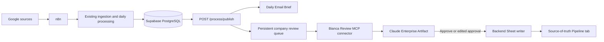

# Sales Pipeline Updates

## Behavior

The founder interface preserves the approved Bianca layout, title **Sales Pipeline Updates**, and owners Ramiro (`RG`),
Nico Casaux (`NC`), and Nico de León (`NDL`). One card holds the context and next actions for one pipeline company.

- **Approve** writes the reviewed bullet list to that company's `Next step` cell.
- **Edit → Save & approve** writes the founder's edited bullets instead.
- Both replace `Last progress` with the **exact previous `Next step`**, including an empty cell. The previous Last progress
  is overwritten, not appended; before/after values remain in the backend decision audit.
- **Ignore** dismisses the card for all founders without writing any Sheet cell. It remains in the activity history.

`artifacts/sales-pipeline-updates.html` is the live app. It starts without company data and requires a configured connector
or authenticated access on the hosted backend. `sales-pipeline-updates-demo.html` is the separate fictional-data preview.
Real company data and credentials are never written to browser storage. Server records are shared by all reviewers.

## How it connects



The queue reuses the commercial classifications and quotation-validated insights already extracted for the brief.
It does not run a second summarization model, reuse the brief watermark, or apply the brief's four-company display cap.
Every active pipeline company with unreviewed linked commercial Gmail, meeting-note, or calendar records can get a card.
Unknown/unlinked companies first need an authoritative pipeline row and entity resolution in the existing ingestion flow.

The initial build scans all unreviewed stored commercial records. Later builds consume stable source-content versions,
so re-extracting the same text with new insight UUIDs does not recreate an approved/ignored suggestion. New information
creates a new card; while a card is pending, new information updates its revision and invalidates older editor snapshots.
Calendar cancellation status is part of source identity. Title-only or otherwise unextracted updates say that an email,
note, or scheduled/cancelled meeting was recorded and ask the founder to review it; they do not invent buying intent.

## Deploy the backend

1. Check out this branch and install the locked Python dependencies with `uv sync` in `backend/`.
2. Apply migrations with `uv run python -m scripts.migrate`. This adds proposals, durable decisions, and consumed-source receipts.
   Existing domain tables and the new tables retain RLS with backend-only access.
3. Enable the Google Sheets API in the service account's Google Cloud project. Share the intended spreadsheet with that
   service-account email as **Editor**. The application only reads the configured tab and writes the two review cells.
4. Configure server secrets and settings below, then set `REVIEW_ENABLED=true`. Set `PUBLIC_BASE_URL` to the real HTTPS backend.
   Never place the ingest token, founder tokens, or service-account JSON in an artifact or committed file.
5. Open `/review/app` on the backend for the same-origin hosted version. Sign in with an assigned founder token; it is held
   only in page memory. Each API request authenticates separately. `/review/demo` contains fictional data only.

| Setting | Purpose |
| --- | --- |
| `REVIEW_ENABLED` | Defaults to `false`; gates all review and publish routes. |
| `REVIEW_TOKENS` | JSON mapping of `RG`, `NC`, `NDL` to **distinct**, random bearer tokens of at least 32 characters. Configure only enabled reviewers. |
| `REVIEW_SPREADSHEET_ID` | The intended source-of-truth spreadsheet ID from its Google URL. |
| `REVIEW_SHEET_TAB` | Exact tab name, default `Pipeline`. |
| `REVIEW_GOOGLE_SERVICE_ACCOUNT_JSON` | Full service-account credential as one JSON environment secret. |
| `REVIEW_BUILD_BATCH` | Changed companies per build call, default `20`; repeat while `done=false`. |
| `REVIEW_ALLOWED_ORIGINS` | Explicit Origin allowlist, default `["https://claude.ai"]`; the configured backend origin is also accepted. Server MCP calls may omit Origin. |

Generate separate tokens with `python -c "import secrets; print(secrets.token_urlsafe(48))"` and store them securely.
The existing `INGEST_TOKEN` remains for n8n's ingestion/build endpoints. It cannot authorize a founder decision.

## Connect the Enterprise Artifact

The backend provides a stateless Streamable HTTP MCP endpoint at `https://<backend>/review/mcp`, with:

- `bianca_review_workspace` — read shared pending cards, mirrored pipeline cells, and recent decisions.
- `bianca_approve_update` — apply the explicitly reviewed original/edited bullets.
- `bianca_ignore_update` — dismiss a proposal without a Sheet write.

An authorized Enterprise administrator adds a custom remote connector with that endpoint and an `Authorization: Bearer <token>`
request header. Use the viewing founder's **individual** credential/connection. **A shared request-header credential attributes
every action to the founder owning that token; it does not prove the viewer's Enterprise identity.** If the organization's
connector configuration cannot isolate per-founder headers, create separately access-controlled founder connectors or put an
OAuth identity gateway in front of these endpoints before enabling individual audit attribution. OAuth/SSO is not implemented here.

Enable artifacts and artifact connectors in the organization's settings. Each founder connects and grants access to the review
tools. Publish the live HTML privately using [the account-specific publishing instructions](../artifacts/claude-publish-prompt.md).
The exact Claude JavaScript connector bridge is generated/validated inside the actual account; the shipped client exposes the
small `window.biancaConnector.callTool(name, args)` integration point and otherwise shows a connection-required state.
It never guesses an undocumented native bridge, embeds credentials, or directly calls an external Render URL from the artifact.

This branch supplies the backend, tools, UI, and setup instructions; it does **not** publish or authorize an artifact in an
Enterprise account. Validate the account's actual connector behavior using a designated test Sheet before production activation.

Official references: [Claude connector-backed artifacts](https://code.claude.com/docs/en/artifacts#pull-live-data-with-mcp-connectors),
[custom remote connector setup](https://support.claude.com/en/articles/11175166-get-started-with-custom-connectors-using-remote-mcp),
[Streamable HTTP](https://modelcontextprotocol.io/specification/2025-06-18/basic/transports).

## n8n: generate the brief and review queue in parallel

Keep the existing four ingestion paths and `/process/daily` loop. After the loop returns both `done=true` and `stage="done"`,
replace its brief-build call with `POST /process/publish?version=v2`, authenticated with `X-Ingest-Token`.
This endpoint independently runs the existing brief builder and the review builder in two workers. It rejects a daily run that
is absent, incomplete, or `timed_out`; existing `/process/daily` and `/brief/build` behavior is unchanged.

The response has independent `brief` and `review` results:

```json
{
  "brief": {"ok": true, "result": {"subject": "...", "html": "...", "text": "...", "to": "..."}},
  "review": {"ok": true, "result": {"created": 6, "updated": 0, "remaining": 0, "done": true}}
}
```

In n8n:

1. Send the email only when `brief.ok` is true, using `brief.result.subject`, `.html`, `.text`, and `.to`.
2. If `review.ok` is true but `review.result.done` is false, repeat `POST /review/build` until it returns `done=true`.
3. If one branch fails, retry **that branch only**: `/brief/build?version=v2` or `/review/build`. Repeating `/process/publish`
   builds another brief and advances its history again; do not use it as the retry for a failed review build.
4. Continue the full Pipeline-sheet sync on its usual schedule; a successful approval also refreshes the backend mirror when
   its reviewed baseline is still current. If `mirror_refreshed=false`, trigger the existing **full** pipeline sync before relying
   on its cache. Never send a partial pipeline snapshot: the existing ingest treats absent companies as removed.

You can choose `version=v1` explicitly if the live email workflow still uses v1. Review generation remains independent.
No n8n workflow or production email settings are changed merely by committing this branch.

## Approval and recovery

The server scopes every lookup to the configured workspace, verifies the card revision, and serializes decisions for that
proposal. It resolves the current Sheet row by normalized `Empresa` and resolves `Last progress`/`Next step` by their headers
on every attempt. Missing/duplicate companies or headers, formulas in review cells, and changed reviewed values stop the write.
Fixed before/after values and the request hash are committed **before** the Google write is attempted. Both cells are written as literal
strings in a single atomic `spreadsheets.batchUpdate` and then read back. Other cells and formatting are untouched.

If a response is lost, the card remains `applying`, with the exact retry payload. Retry that saved approval: the writer recognizes
the desired final cell values and never rotates them a second time. Another founder cannot replace that in-flight decision.
A completed request returns the original result when retried with its original key and payload. Ignore consumes the reviewed
source versions but never initializes Google credentials or makes a Sheets request.

If the Sheet changed before the first write, resync the Pipeline tab, rebuild proposals, and review the new revision.
If an earlier write might have succeeded and a later human edit makes both snapshots differ, the saved intent stays applying.
An operator must reconcile the recorded before/after values with the Sheet before retrying; the service will not discard an
uncertain write and rotate again. Preserve audit records. Do not edit them to pretend an unverified write succeeded.

**Google Sheets has no cell-level compare-and-swap.** The read/check and atomic write are separate requests. Human edits,
sorting, or another external writer in the narrow interval can race them. Backend locks prevent competing approvals through
this service, but cannot lock the Google UI. Avoid concurrent sorting/manual editing of these cells during approval and
validate this workflow on a test Sheet. The readback and durable audit help detect/recover uncertain outcomes; they do not
claim to eliminate that provider limitation. [Google batch update behavior](https://developers.google.com/workspace/sheets/api/reference/rest/v4/spreadsheets/batchUpdate)

## Verification

```sh
cd backend
uv run pytest
cd ..
node tests-frontend/verify-live.cjs
node tests-frontend/verify-demo.cjs
```

Tests use dummy database credentials and mocked Google/Claude connections. They cover review transport/auth, source receipts,
revision changes, NDL, exact cell replacement, Ignore, durable retries, stale data, moved headers/rows, literal writes, and
frontend error recovery. Live Google credentials, the production database, and the Enterprise runtime bridge are not exercised
by these tests. Browser appearance needs verification in the deployment environment.
