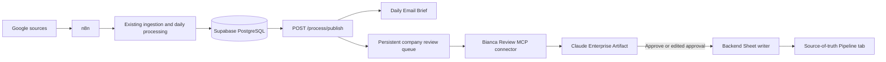

# Sales Pipeline Updates

## Behavior

The founder interface preserves the approved Bianca layout, title **Sales Pipeline Updates**, and owners Ramiro (`RG`),
Nico Casaux (`NC`), and Nico de León (`NDL`). One card holds the context and next actions for one pipeline company.

- Before priority selection, next steps, commitments, and blockers are action candidates; customer needs, buying signals, and objections are Client Context candidates. Only selected items become proposed updates. Passive customer obligations and standalone blocker status stay in supporting detail. Routing uses the stored insight type, not the wording of an editable bullet.
- **Approve** sends both reviewed lists. **Edit → Save & approve** uses separate editors for the founder's changes.
- If action bullets are present, they replace `Next step` and its **exact previous value replaces `Last progress`**, including an empty old Next step. The previous Last progress is overwritten, not appended.
- If context bullets are present, they are added to existing `Client Context`, deduplicating equivalent bullet lines. The existing text is preserved. An empty approved section leaves its corresponding cells unchanged, so context-only approval never rotates action cells.
- Before/after values for all three cells and the exact destination are stored in the durable audit.
- **Ignore** dismisses the card for all founders without writing any Sheet cell. It remains in the activity history.

### Priority selection (11/23/2026)

Extraction remains comprehensive. With `REVIEW_PRIORITY_SELECTION_ENABLED=true` (the default), a separate
selection step chooses the important updates from the eligible, deduplicated evidence. **Usually 0–3 bullets
per section** is a strong preference, not a quota or a maximum. Return fewer when little matters; retain more
when multiple distinct important items are warranted. No selected list is truncated to meet that preference.

- **Suggested next steps:** unresolved actions Bianca can take now that materially advance a commercial
  decision or address a significant commercial risk. Routine login/access/adoption checks do not qualify merely
  because a founder owns them, they have a date, or two follow-ups went unanswered. An explicit consequential
  commercial dependency can make a related action important. Passive promises that the customer will review,
  discuss internally, or get back to Bianca stay in supporting detail; they are not rewritten into invented
  follow-ups. Completed Bianca work is history, even if a customer decision remains pending.
- **Client context:** the few facts that materially change the sales approach: central needs and desired outcomes,
  decisive buying criteria, substantive objections, and purchasing constraints. Prefer representative facts over
  repeated descriptions of the same theme. Consider existing Sheet context when deciding whether a proposed
  addition is useful. Routine activity, generic interest, and waiting status do not move here just because they
  were excluded from Next Steps. Older evidence can remain central; recency alone does not determine importance.
- The model selects existing bullet IDs in priority order. Code retains their exact text, owners, requested-versus-
  agreed dates, and source lineage, and rejects invalid or cross-section selections. It does not invent actions or
  compress unrelated tasks into one bullet to achieve a count. Supporting details on a selected card are collapsed
  and explicitly excluded from its approval. A company with no meaningful proposed updates needs no new card.
- Selection is cached against its evidence, deal context, policy version, and review date. Approval revalidates the
  saved selection against current evidence without another model call. Failed or invalid model responses stop the
  build rather than falling back to the previous broad list. `REVIEW_SELECTION_BATCH` defaults to two uncached
  model calls per request; repeat builds until `done=true`. Cached and empty results need no model call.
- Approve and Ignore account for the selected candidates only. Deferred candidates are retained, including when
  they share a source with a selected bullet. They can be reconsidered when circumstances change. Older source-level
  receipts remain honored. This does not recover evidence already consumed by a previous approval under legacy rules.

The change selects concise **proposed updates**; it does not automatically rewrite a founder's existing Sheet cells.
Client Context approval still appends by default, so historical Sheet context remains available in Current Sheet cells.
Existing context may need a separately reviewed cleanup if a concise replacement of that whole cell is desired.

Rollout: apply `uv run python -m scripts.migrate --sheet-review` (includes `021_review_priority_selection`),
configure the existing Anthropic API key/model settings, then run `/review/build?force=true` to completion to rebuild
pending cards. Keep already-applying approvals on their saved retry path. Review representative examples with the
founders, including the login check, both customer-review promises, a commercially critical access dependency,
zero relevant items, older important context, and a deal with more than three independent priorities. Automated
tests validate selection contracts and review persistence with simulated model responses; live semantic quality
still needs that staging review. `REVIEW_PRIORITY_SELECTION_ENABLED=false` supports deployments that have not
started priority review. Once priority cards or candidate decisions exist, disabling selection cannot safely restore
source-level review: builds refuse that switch rather than reintroducing reviewed items or consuming deferred siblings.
Keep selection enabled for that lifecycle. The legacy `REVIEW_MAX_*` values are ignored when selection is enabled.

### Legacy card limits, order and Status (11/16/2026)

- **Order.** Next Step bullets lead with Bianca's own actions, newest first, then items with no clear owner, then customer-owed items, then blockers. Two wordings of the same step (at least three in four meaningful words shared, four words minimum) become one bullet that keeps both sources.
- **Legacy limit (priority selection disabled only).** A card suggests at most `REVIEW_MAX_NEXT_STEPS` next steps (default 4) and `REVIEW_MAX_CONTEXT` context bullets (default `0` = no limit). The newest stay. Sources that supported only removed bullets are recorded on the card (`source_versions`), so legacy Approve or Ignore retires them. The enabled priority-selection path above does not use this cap or retire deferred candidates.
- **Status.** `POST /review/rows/{row_id}/status` with `{"expected_status", "status"}` (tool `bianca_set_status`) writes the one Status cell of that company after checking it still holds the value the founder saw. Only labels already used in the Sheet's Status column are accepted. The pipeline mirror and `opportunity_changes` are updated; the change is logged in `sync_runs` with source `sheet_review_status:<founder>`. It is a single-cell write, so the n8n Sheets proxy needs no change.
- **Dates.** The editor's Complete by field is plain text read day first (`16/11/2026`, `16/11`, `16 Nov`, `16 de noviembre`), independent of the browser language. An impossible date shows why and blocks Save & approve. The Sheet text stays `(complete by Nov 16, 2026)`.
- **After deploying this change** run `/review/build?force=true` until `done=true`: pending cards built before it hold the old order and are refused at approval with "The sales evidence changed" until rebuilt.

### Hub fixes from the 11/12 founder session (11/17/2026)

- **Keep current bullets + add these (H-16).** The approve payload takes an optional `next_step_mode`: `"replace"` (default, unchanged: approved steps become `Next step` and the old `Next step` moves to `Last progress`) or `"append"`. In append the server leaves `Last progress` untouched and adds the approved steps below the existing `Next step` text, which is kept byte for byte; a step already in the cell (bullet mark, case and spacing ignored) is not repeated. It is the same rule Client Context append uses. The plan goes through the same live-row check, saved before/after values, single batch write and read-back as a replace. The mode is part of the request identity, so one approval key cannot be reused to switch modes; a saved approval reports its mode in `retry.next_step_mode` (recovered from the request hash, no new column). REST and `bianca_approve_update` both accept the field; a page that never sends it gets replace. The page now sends only the new steps in Keep + add (it used to re-send the Sheet's current bullets), and the card hint and the editor's "What will happen in the Pipeline Sheet" box describe the selected mode.
- **Already answered by email (H-06, the part that can be proven from stored data).** The daily brief lists what a customer asked by email only while the customer wrote last in that thread; the hub kept suggesting those asks until someone decided the card. Now a `Next step:` bullet taken from a customer's email is left off the card when a later email in the same thread was sent by Bianca (or the Kellogg team) to someone outside Bianca, or when a founder marked that thread done in the brief at or after the customer's email. Automatic replies, internal forwards, replies linked to another company and replies whose extracted items are all outside sales do not count. Promises (`We owe:`), items from meeting notes, customer-owed items and blockers are never dropped by this rule. The build and the approval re-check read the same inputs: only mail and Done clicks stored by the start of the review cycle (`review_queue_state.cycle_started_at`), so a reply that arrives later changes the card at the next build and does not block an approval in between. What this does not cover is listed under "Known limits" below.
- **No "keep following up" bullets (B-10).** A next step or commitment that is only a nudge with no topic and no date - "Keep following up with Andina", "Continue to follow up", "Send a follow-up", "Follow up with the customer" - is left off the card (`is_vague_followup` in `review_content.py`). Anything with a subject matter or a time stays ("Follow up on the pricing proposal", "Follow up next week"), and so does a bare "Follow up with Renzo" because it names who to write to. Items with a due date, customer-owed items, blockers and Client Context are never dropped by this rule. The time-based nudge the founders asked for instead ("it has been N weeks") is the brief's "Waiting on their reply" section; the hub does not add one.
- **Waiting on them (H-10).** Each Next Step bullet now records who it is with in its lineage node (`side`: `bianca`, `unassigned`, `customer`, `blocker`), taken from the insight's owner when the card is built. The workspace view adds `waiting: true` to a pending card whose Next Step bullets are all customer-owed or blockers, `false` when at least one is not, and leaves the field out when the card has no Next Step bullets or was built before this change. In the War room layout the agenda shows "Needs your action" first and "Waiting on them" below; J / K and Prev / Next follow that order, and the "to review" counts still count every pending card. Waiting cards can be approved, edited and ignored like any other.
- **Saving state (H-11).** While a decision is on its way, the card is dimmed with a moving bar, every control on it is disabled and the Approve (or Retry) button reads "Saving to Sheet..." with a spinner; in the editor Save & approve reads the same and the form is dimmed. The state survives a re-render and clears on success, failure or disconnect. A second click or submit sends nothing. The editor's button row now stays visible at the bottom of the dialog while the form scrolls, so Save & approve is always on screen.
- **Sheet calls per approval (H-11): 4, unchanged.** (1) `_prepare` reads the tab to take the row's exact text for the saved before/after values and to stop early if the row changed; (2) `apply_update` reads it again immediately before writing (the compare step); (3) one `batchUpdate`; (4) the read-back that confirms the write. The page's refresh afterwards adds one read of the Status column through `/review/workspace`. None of these is redundant: the saved plan needs the Sheet's exact bytes before the write is attempted, and reusing read (1) in place of read (2) would move the compare step from just before the write to before two database commits, which widens the window in which a founder's manual edit could be overwritten. That trade (about one round trip saved per approval) is a team decision, not a safe cleanup, so it was not made.
- **After deploying these changes** run `/review/build?force=true` until `done=true`. Pending cards built earlier hold lineage without `side`, and may hold a bullet the new rules drop, so they are refused at approval with "The sales evidence changed" until rebuilt. `ROUTING_VERSION` is unchanged: the columns each bullet type goes to did not change.

**Known limits of already-done detection (11/17/2026).** The hub hides a step only when its insight is `done`, `possibly_done` or `dismissed`, or by the email rule above. `possibly_done` is set only by `POST /process/reconcile` (one Claude call per deal). `/process/daily` runs that stage only when it is called without `sync_batch_id`; a verified run (`sync_batch_id` set) skips it because the brief re-checks its own selected actions at build time and stores those verdicts in `brief_verification_runs`, which the hub does not read (they are tied to one build's snapshot). In that flow the hub gets no completion signal apart from a founder's Done click. A promise fulfilled in another thread, something done outside email (NDA signed, workflow built) and "a meeting was proposed and is now on the calendar" cannot be proven without a model call or data the tables do not hold (calendar records store no creation time, so a newly scheduled meeting cannot be told from a standing one).

`artifacts/sales-pipeline-updates.html` is the live app. It starts without company data and requires a configured connector
or authenticated access on the hosted backend. `sales-pipeline-updates-demo.html` is the separate fictional-data preview.
Real company data and credentials are never written to browser storage. Server records are shared by all reviewers.

The default destination is [the designated Pipeline tab](https://docs.google.com/spreadsheets/d/14lXRsWoEY63tOsz4SwggiItgTNPFWI4KDVTLay3MLDw/edit?gid=1869050409#gid=1869050409): spreadsheet `14lXRsWoEY63tOsz4SwggiItgTNPFWI4KDVTLay3MLDw`, tab `Pipeline`, numeric sheet ID `1869050409`. Overrides must deliberately name another authorized environment, including its sheet ID. The service checks the numeric tab ID as well as the title.

## How it connects



The queue reuses the Daily Brief's per-insight sales scope. It accepts deal progression and legacy insights with blank scope
from unreviewed, linked commercial sources for active pipeline companies. Delivery and out-of-scope insights stay out of
both writable sections. Each suggestion requires a supporting quote, tied to its exact source when available. A source
without a qualifying insight produces no suggestion.

The first review cycle imports only records whose `occurred_at` falls inside the inclusive interval from initialization minus
14 days through initialization. The database persists that boundary and the original versions excluded as undated or outside
the interval. All initially stored source versions are considered for exclusion, including records not yet classified or linked;
the older backlog therefore cannot leak back in when those records are classified later. Sources are retained in Supabase;
this window controls the review queue, not the existing brief's ingestion.

After bootstrap, there is no rolling date cutoff. New records and changed source-content versions become eligible during
later daily checks, including a newly arrived historical item or a real update to an excluded old version. The unchanged
initially excluded version stays excluded. Re-extracting the same text with new insight UUIDs does not create new source content.

While a company card is pending, each build refreshes its bullets against current eligible evidence and combines the supporting
sources for duplicate text. The initial 14-day window does not limit later cycles. If a reclassification or changed source
removes eligibility, the next build revises the card or supersedes it if empty. A newer revision invalidates the older editor
snapshot. Approve, Save & approve, and Ignore consume the reviewed source versions. Superseding an empty card leaves its source
versions available for later review if evidence qualifies.

## Daily cycles and source lineage

Migration 014 adds workspace review state, bootstrap exclusions, current observed source versions, and per-bullet lineage on
proposals/decisions. Initialization, exclusions, and a build batch commit together. Failed attempts roll back; retries resume the
persisted cutoff and unfinished cycle. Batches can continue across requests and midnight. Once a cycle completes, normal calls
on the same workspace calendar date return `done:true, skipped:true`. The next date starts another cycle. The workspace timezone
controls the date, independently of the viewer's browser timezone.

The graph is explicit: every source has an ID derived from source type, external identity, and content version. Each aligned
`bulletLineage.nextStep[]` or `.clientContext[]` entry contains `bulletId`, the exact `text`, and `sourceIds`. A source edge is
created only when the supporting passage is validated against that record. Duplicate bullets retain the union of their supporting
source IDs. Two emails on the same date remain distinct. New approvals check current eligibility before writing to the Sheet.

Clicking a source button highlights only its linked bullets across both destinations, with a pressed state and announced match count.
Selection is local to its company card and survives refresh while the source still exists. Missing or malformed metadata shows an
explicit tracing-unavailable state rather than guessing from labels. Founder-edited text gets no original source edges unless it
matches an original bullet in the same destination; manual edits are recorded as `founder_edit` in the decision lineage.

## Deploy the backend

1. Check out this branch and install the locked Python dependencies with `uv sync` in `backend/`.
2. Apply migrations with `uv run python -m scripts.migrate --sheet-review`. Migrations 012–014 add proposals, decision history,
   source receipts, Client Context, daily queue state, and source lineage. The default migration command defers these three files.
   Existing domain tables and the new tables retain RLS with backend-only access.
3. Enable the Google Sheets API in the service account's Google Cloud project. Share the intended spreadsheet with that
   service-account email as **Editor**. The application reads the configured tab and writes only changed values among Client Context, Last progress, and Next step.
4. Configure server secrets and settings below, then set `REVIEW_ENABLED=true`. Set `PUBLIC_BASE_URL` to the real HTTPS backend.
   Never place the ingest token, founder tokens, or service-account JSON in an artifact or committed file.
5. Open `/review/app` on the backend for the same-origin hosted version. Sign in with an assigned founder token; it is held
   only in page memory. Each API request authenticates separately. `/review/demo` contains fictional data only.

| Setting | Purpose |
| --- | --- |
| `REVIEW_ENABLED` | Defaults to `false`; gates all review and publish routes. |
| `REVIEW_TOKENS` | JSON mapping of `RG`, `NC`, `NDL`, `MG` to **distinct**, random bearer tokens of at least 32 characters. Configure only enabled reviewers. |
| `REVIEW_SPREADSHEET_ID` | Defaults to `14lXRsWoEY63tOsz4SwggiItgTNPFWI4KDVTLay3MLDw`; check existing environment overrides. |
| `REVIEW_SHEET_TAB` | Exact tab name, default `Pipeline`. |
| `REVIEW_SHEET_ID` | Numeric tab ID, default `1869050409`; validates that the named tab is the intended destination. |
| `REVIEW_CLIENT_CONTEXT_MODE` | Default `append`, matching the approved behavior: preserve context and add distinct bullets. `replace` is an explicit deployment override, not the founders' selected default. |
| `REVIEW_GOOGLE_SERVICE_ACCOUNT_JSON` | Full service-account credential as one JSON environment secret. |
| `REVIEW_BUILD_BATCH` | Changed companies per build call, default `20`; repeat while `done=false`. |
| `REVIEW_ALLOWED_ORIGINS` | Explicit Origin allowlist, default `["https://claude.ai"]`; the configured backend origin is also accepted. Server MCP calls may omit Origin. |

Generate separate tokens with `python -c "import secrets; print(secrets.token_urlsafe(48))"` and store them securely.
The existing `INGEST_TOKEN` remains for n8n's ingestion/build endpoints. It cannot authorize a founder decision.

### Upgrade from the original review format

Deploy the API, live HTML, connector schema, and migrations through 014 together. After migration, sync the **full Pipeline tab including Client Context from the new target spreadsheet**, complete source processing, and run `/review/daily` until `done=true`. To intentionally repair or rebuild on an already completed day, use `/review/build?force=true` and drain all batches. Force never resets initialization or exclusions. Pending legacy cards are rebuilt from eligible typed insights with real lineage; an old card with no eligible material can be superseded. Do not infer categories or edges from old flat text. Existing `REVIEW_SPREADSHEET_ID` environment values override the new code default and must be updated deliberately.

Old `bullets`-only approval requests are rejected; the new payload requires `next_step_bullets` and `client_context_bullets`, either of which may be empty while the combined request must be nonempty. Old applying requests without typed routing/target binding require operator reconciliation. They are never replayed into a new destination. New intents bind spreadsheet ID, tab name, and numeric tab ID; changing configuration cannot silently redirect an in-flight write.

Previously saved typed applying approvals remain recoverable even if they predate lineage; their retry payload and target remain authoritative. Their source buttons show tracing unavailable instead of fabricating edges. Do not delete `review_queue_state` or exclusions as a routine deployment/reset step: that would create another first-run window.

## Connect the Enterprise Artifact

The backend provides a stateless Streamable HTTP MCP endpoint at `https://<backend>/review/mcp`, with:

- `bianca_review_workspace` — read shared pending cards, mirrored pipeline cells, and recent decisions.
- `bianca_approve_update` — apply the explicitly reviewed original/edited bullets.
- `bianca_ignore_update` — dismiss a proposal without a Sheet write.

An authorized Enterprise administrator adds a custom remote connector with that endpoint and an `Authorization: Bearer <token>`
request header. Use the viewing founder's **individual** credential/connection. **A shared request-header credential attributes
every action to the founder owning that token; it does not prove the viewer's Enterprise identity.** If the organization's
connector configuration cannot isolate per-founder headers, create separately access-controlled founder connectors or put an
OAuth identity gateway in front of these endpoints before enabling individual audit attribution. OAuth/SSO is not implemented here.

Enable artifacts and artifact connectors in the organization's settings. Each founder connects and grants access to the review
tools. Publish the live HTML privately using [the account-specific publishing instructions](../artifacts/claude-publish-prompt.md).
The exact Claude JavaScript connector bridge is generated/validated inside the actual account; the shipped client exposes the
small `window.biancaConnector.callTool(name, args)` integration point and otherwise shows a connection-required state.
It never guesses an undocumented native bridge, embeds credentials, or directly calls an external Render URL from the artifact.

This branch supplies the backend, tools, UI, and setup instructions; it does **not** publish or authorize an artifact in an
Enterprise account. Validate the account's actual connector behavior using a designated test Sheet before production activation.

Official references: [Claude connector-backed artifacts](https://code.claude.com/docs/en/artifacts#pull-live-data-with-mcp-connectors),
[custom remote connector setup](https://support.claude.com/en/articles/11175166-get-started-with-custom-connectors-using-remote-mcp),
[Streamable HTTP](https://modelcontextprotocol.io/specification/2025-06-18/basic/transports).

## n8n: generate the brief and review queue in parallel

Keep the existing four ingestion paths and `/process/daily` loop. Post the full Pipeline snapshot with
`coverage_complete:true` and retain the returned `sync_run_id`. After processing returns `stage="done"`,
call `POST /process/publish?version=v2&pipeline_sync_run_id=<uuid>`, authenticated with `X-Ingest-Token`.
This endpoint independently runs the existing brief builder and the review builder in two workers. It rejects a daily run that
is absent, incomplete, `timed_out`, or still has pending source records; existing `/process/daily` and `/brief/build` behavior is unchanged.

The response has independent `brief` and `review` results:

```json
{
  "brief": {"ok": true, "result": {"subject": "...", "html": "...", "text": "...", "to": "..."}},
  "review": {"ok": true, "result": {"created": 6, "updated": 0, "remaining": 0, "done": true}}
}
```

In n8n:

1. Send the email only when `brief.ok` is true, using `brief.result.subject`, `.html`, `.text`, and `.to`.
2. If `review.ok` is true but `review.result.done` is false, call `POST /review/daily` with the same receipt until it returns `done=true`.
3. If one branch fails, retry **that branch only** using the same receipt on `/brief/build?version=v2` or `/review/daily`. Repeating `/process/publish`
   builds another brief and advances its history again; do not use it as the retry for a failed review build.
4. Continue the full Pipeline-sheet sync on its usual schedule; a successful approval also refreshes the backend mirror when
   its reviewed baseline is still current. The mirror now includes Client Context. If `mirror_refreshed=false`, trigger the existing **full** pipeline sync before relying
   on its cache. Never send a partial pipeline snapshot: the existing ingest treats absent companies as removed.

You can choose `version=v1` explicitly if the live email workflow still uses v1. Review generation remains independent.
No n8n workflow or production email settings are changed merely by committing this branch.

For a dedicated review branch, import [the supplied n8n subworkflow](../n8n/sales-pipeline-updates-daily.json) and follow
[its setup instructions](../n8n/README.md). Invoke it with `pipeline_sync_run_id` after ingestion and processing.
It calls `POST /review/daily` and drains batches without generating another brief.

`POST /review/build?force=true` is an ingest-authenticated manual repair path, not a normal scheduler setting. Approvals do not
trigger a new build. New same-day arrivals after a completed cycle wait for the next normal daily cycle unless an operator explicitly rebuilds.

## Approval and recovery

The server scopes every lookup to the configured workspace, verifies the card revision, and serializes decisions for that
proposal. It resolves the current Sheet row by normalized `Empresa` and resolves `Last progress`/`Next step` by their headers
on every attempt, together with `Client Context`. Missing/duplicate companies or headers, a mismatched numeric tab ID, formulas in review cells, and changed reviewed values stop the write.
Fixed before/after values and the request hash are committed **before** the Google write is attempted. Changed cells are written as literal
strings in a single atomic `spreadsheets.batchUpdate` and then read back across all three review cells. Only changed cells are included in the write; other cells and formatting are untouched.

If a response is lost, the card remains `applying`, with the exact retry payload. Retry that saved approval: the writer recognizes
the desired final cell values and never rotates them a second time. Another founder cannot replace that in-flight decision.
A completed request returns the original result when retried with its original key and payload. Ignore consumes the reviewed
source versions but never initializes Google credentials or makes a Sheets request.

If the Sheet changed before the first write, resync the Pipeline tab, rebuild proposals with `/review/build?force=true` if today's cycle already completed, and review the new revision.
If an earlier write might have succeeded and a later human edit makes both snapshots differ, the saved intent stays applying.
An operator must reconcile the recorded before/after values with the Sheet before retrying; the service will not discard an
uncertain write and rotate again. Preserve audit records. Do not edit them to pretend an unverified write succeeded.

**Google Sheets has no cell-level compare-and-swap.** The read/check and atomic write are separate requests. Human edits,
sorting, or another external writer in the narrow interval can race them. Backend locks prevent competing approvals through
this service, but cannot lock the Google UI. Avoid concurrent sorting/manual editing of these cells during approval and
validate this workflow on a test Sheet. The readback and durable audit help detect/recover uncertain outcomes; they do not
claim to eliminate that provider limitation. [Google batch update behavior](https://developers.google.com/workspace/sheets/api/reference/rest/v4/spreadsheets/batchUpdate)

## Verification

```sh
cd backend
uv run pytest
cd ..
node tests-frontend/verify-live.cjs
node tests-frontend/verify-demo.cjs
```

Tests use dummy database credentials and mocked Google/Claude connections. They cover review transport/auth, source receipts,
revision changes, NDL, first-run cutoff/exclusions, daily gates and resumable batches, accumulated pending cards, per-bullet source graphs, typed category routing, context append/deduplication, context-only preservation of action cells, exact cell replacement, Ignore, durable retries/target binding, stale data, moved headers/rows, literal writes, and
frontend error recovery. Live Google credentials, the production database, and the Enterprise runtime bridge are not exercised
by these tests. Browser appearance needs verification in the deployment environment.
